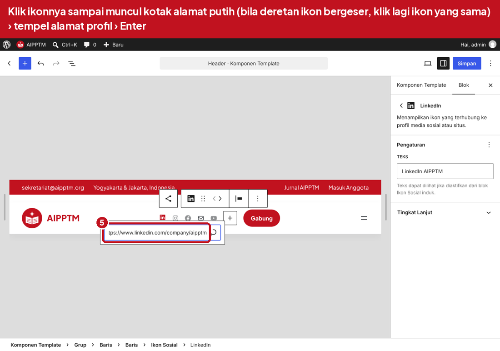

# Panduan Website AIPPTM

Website utama **www.aipptm.org** memakai WordPress, jurnal **journal.aipptm.org** memakai OJS 3.5.
Keduanya berjalan di satu server Google Cloud, dengan email dan login Google untuk domain `aipptm.org`.

Tampilan website berwarna dasar putih dengan aksen merah dan footer merah. Susunan beranda:
banner utama, angka statistik, mozaik Sorotan (agenda, publikasi, layanan), sambutan Ketua Umum
dengan visi dan misi, direktori anggota PTM, divisi dan program kerja, publikasi, lalu berita.
Gambar bawaan tema hanyalah contoh dan bisa diganti langsung dari editor.

## Isi paket

| File | Kegunaan |
|---|---|
| `aipptm-tema.zip` | Tema WordPress AIPPTM, diunggah lewat Tampilan › Tema atau dipasang otomatis oleh skrip |
| `tema/aipptm/` | Isi tema yang sama dalam bentuk folder |
| `server/setup-server.sh` | Skrip pemasang server: Apache, PHP 8.3, MariaDB, WordPress, OJS 3.5, HTTPS, backup |
| `pratinjau-beranda.png` | Tampilan beranda hasil uji di WordPress 7.1.3 |
| `tutorial-media-sosial.html` dan `panduan-gambar/` | Tutorial bergambar mengubah ikon media sosial |

## Gambaran sistem

| Bagian | Isi |
|---|---|
| Server | 1 VM Google Compute Engine di Jakarta, Ubuntu 24.04, Apache dan PHP 8.3 |
| www.aipptm.org | WordPress |
| journal.aipptm.org | OJS 3.5 |
| Database | MariaDB di VM yang sama, dipakai WordPress dan OJS |
| Cadangan | Dump database harian di VM dan snapshot disk harian di Google Cloud |
| Email dan login | Google Workspace untuk email @aipptm.org dan tombol "Masuk dengan Google" |

---

## 1. Perkiraan biaya bulanan

Google Cloud *pay as you go* menagih VM per detik selama menyala, disk per GB, IP statis, dan
lalu lintas keluar. Tidak ada tagihan "per pemakaian database", karena database sengaja dipasang
di dalam VM (bukan Cloud SQL).

| Komponen | Perkiraan |
|---|---|
| VM **e2-medium** (2 vCPU, 4 GB RAM) di Jakarta, disarankan | sekitar US$33 per bulan |
| atau VM **e2-small** (2 GB RAM) untuk mulai hemat | sekitar separuhnya |
| Disk 30 GB *balanced*, IP statis, dan snapshot | sekitar US$5 sampai 8 per bulan |
| Google Workspace Business Starter | sekitar US$7 sampai 8,4 per pengguna per bulan |

Angka di atas perkiraan. Cek harga terbaru di
[Kalkulator Harga Google Cloud](https://cloud.google.com/products/calculator) dan
[harga Google Workspace](https://workspace.google.com/pricing). Ukuran VM bisa dinaikkan atau
diturunkan kapan saja: Stop VM, Edit, ubah *machine type*, lalu Start.

## 2. Google Workspace (email @aipptm.org)

1. Daftar di [workspace.google.com](https://workspace.google.com), pilih **Business Starter**,
   lalu masukkan domain `aipptm.org`.
2. Ikuti verifikasi domain (menambah record **TXT** di pengelola DNS domain).
3. Tambahkan record email yang diminta Google (biasanya **MX** `smtp.google.com`).
4. Agar email dari website tidak masuk spam, tambahkan juga:
   * **SPF** (TXT di `@`): `v=spf1 include:_spf.google.com ~all`
   * **DKIM**: Admin Console › Aplikasi › Google Workspace › Gmail › *Autentikasi email*,
     buat kunci, lalu salin record TXT `google._domainkey`.
   * **DMARC** (TXT di `_dmarc`): `v=DMARC1; p=none; rua=mailto:admin@aipptm.org`
5. Buat akun `admin@aipptm.org`. Buat juga grup gratis `info@aipptm.org` (alamat yang
   tampil di website) dan `noreply@aipptm.org` (pengirim email otomatis website dan jurnal).

## 3. Google Cloud: project, anggaran, VM

Masuk ke Google Cloud **dengan akun `admin@aipptm.org`** supaya project berada di bawah
organisasi aipptm.org.

1. Buka [console.cloud.google.com](https://console.cloud.google.com), buat project
   `aipptm-web`, lalu hubungkan **Billing**.
2. **Billing › Budgets & alerts**: buat anggaran (misalnya US$60 per bulan) dengan peringatan
   email di 50%, 90%, dan 100%. Ini mencegah tagihan kaget.
3. **Compute Engine › VM instances › Create instance**:
   * Name: `aipptm-server`, Region: `asia-southeast2 (Jakarta)`
   * Machine type: `e2-medium` (atau `e2-small`)
   * Boot disk, klik *Change*: **Ubuntu 24.04 LTS (x86/64)**, *Balanced persistent disk*, **30 GB**
   * Networking/Firewall: centang **Allow HTTP traffic** dan **Allow HTTPS traffic**
   * Klik **Create**.
4. **VPC network › IP addresses**: pada IP eksternal VM pilih **Promote to static IP** agar IP
   tidak berubah. Catat IP ini.
5. **Compute Engine › Snapshots › Create snapshot schedule**: harian, simpan 14 hari, lalu
   pasang jadwal itu ke disk VM (**Disks › aipptm-server › Edit › Snapshot schedule**).

Google Cloud memblokir port email 25 dari VM. Karena itu email website dikirim lewat SMTP
Google Workspace di port 587 (lihat bagian 6, *Email dari website*).

## 4. DNS domain

Di pengelola DNS domain `aipptm.org`, tambahkan record berikut (ganti `IP_VM` dengan IP statis tadi):

| Tipe | Nama | Nilai |
|---|---|---|
| A | `@` | IP_VM |
| A | `www` | IP_VM |
| A | `journal` | IP_VM |
| A | `www.journal` | IP_VM |

Record MX dan TXT dari Google Workspace tetap dibiarkan. Biasanya aktif dalam 5 sampai 60 menit.
Alamat jurnal resmi adalah `journal.aipptm.org`; `www.journal.aipptm.org` otomatis dialihkan ke sana.

## 5. Pasang server (sekali jalan)

1. Di daftar VM, klik tombol **SSH**. Jendela terminal terbuka di browser.
2. Klik ikon **Upload file** (kanan atas), lalu unggah `setup-server.sh` dan `aipptm-tema.zip`.
3. Jalankan:

   ```bash
   sudo bash setup-server.sh --email admin@aipptm.org
   ```

   Prosesnya sekitar 5 sampai 10 menit. Skrip memasang Apache, PHP 8.3, MariaDB, WordPress
   terbaru (checksum dicek), OJS 3.5 LTS, tema AIPPTM, HTTPS Let's Encrypt, backup database
   harian (`/var/backups/aipptm`, disimpan 14 hari), dan update keamanan otomatis.
4. Kata sandi database tersimpan di `/root/aipptm-kredensial.txt`
   (lihat dengan `sudo cat /root/aipptm-kredensial.txt`). Simpan salinannya di tempat aman.

Jika DNS belum aktif saat skrip dijalankan, HTTPS dilewati dengan peringatan. Setelah DNS aktif,
jalankan `sudo bash setup-server.sh --email admin@aipptm.org --ssl-only`.
Skrip aman dijalankan ulang.

## 6. WordPress (www.aipptm.org)

1. Buka `https://www.aipptm.org/wp-admin/install.php` dan pilih **Bahasa Indonesia**.
2. Judul situs `AIPPTM`, nama pengguna (jangan `admin`), kata sandi kuat, email `admin@aipptm.org`.
3. **Pengaturan › Umum**: atur zona waktu ke *Jakarta*.
4. **Tampilan › Tema**: aktifkan **AIPPTM**. Jika belum ada, klik **Tambahkan Tema › Unggah Tema**
   lalu pilih `aipptm-tema.zip`.

Saat tema pertama kali diaktifkan, laman berikut dibuat otomatis: Beranda, Profil AIPPTM,
Pengurus, Direktori Anggota PTM, Cara Bergabung, Divisi & Program Kerja, Publikasi,
Agenda Kegiatan, Kontak, Kebijakan Privasi, dan Berita & Agenda. Beranda dijadikan halaman depan,
Slogan diisi "Asosiasi Ilmu Pemerintahan Perguruan Tinggi Muhammadiyah" (tampil di bawah tulisan
AIPPTM di header), dan logo AIPPTM dipasang sebagai logo situs serta ikon tab browser. Laman atau pengaturan yang sudah ada tidak ditimpa.

### Cara mengedit (tanpa koding)

| Ingin mengubah | Caranya |
|---|---|
| Teks di beranda | **Laman › Semua Laman › Beranda › Sunting**. Klik teksnya lalu ketik. Klik **Simpan** setelah selesai. |
| Foto di beranda | Klik fotonya, lalu **Gantikan** di toolbar, pilih **Unggah** (foto baru) atau **Buka Pustaka Media** (foto yang sudah ada). |
| Foto besar di kotak Agenda | Klik teks di kotak itu, lalu klik **Sampul** pada baris jejak di bawah layar, kemudian **Gantikan**. |
| Laman lain | **Laman › Semua Laman ›** pilih lamannya **› Sunting** |
| Berita | **Pos › Tambah Pos**. Klik **Tetapkan gambar unggulan** agar foto tampil di beranda, lalu **Terbitkan**. |
| Menu, header, footer | **Tampilan › Editor › Pola**, lalu **Header** atau **Footer**. Menu diubah dengan mengklik menunya di dalam Header. |
| Ikon media sosial | Lihat **Tutorial media sosial** di bawah (bergambar) |
| Warna merah | **Tampilan › Editor › Gaya › Warna › Palet**, lalu ubah warna *Merah* |
| Menambah bagian siap pakai | Tombol **+** › tab **Pola** › kategori **AIPPTM** |

Menu jangan diubah lewat *Tampilan › Editor › Navigasi*, karena layar itu membuat menu baru yang
tidak dipakai header.

Bagian beranda yang dikunci susunannya (mozaik Sorotan) tetap bisa diubah teks, tautan, dan
fotonya. Kuncinya hanya mencegah kotak bergeser atau terhapus tanpa sengaja.

### Logo dan ikon situs

Lambang AIPPTM sudah terpasang di header, footer, dan tab browser. Tulisan AIPPTM dan nama
lengkap di sebelahnya diambil dari *Judul Situs* dan *Slogan* di **Pengaturan › Umum**.

Bila suatu saat lambang perlu diganti:

1. **Tampilan › Editor › Pola › Header**, klik logonya, lalu **Gantikan** di toolbar.
   Pakai PNG berlatar transparan, minimal 512 × 512 piksel. Logo di footer ikut berganti.
2. Klik **Simpan**.
3. Ikon tab browser: **Pengaturan › Umum › Ikon Situs**.

### Tutorial media sosial (header dan footer)

Versi bergambar lengkap ada di **`tutorial-media-sosial.html`** (buka dengan browser). Ringkasnya:

1. **Tampilan › Editor › Pola › Header**, lalu klik gambar Header.
2. Klik ikonnya (misalnya LinkedIn) sampai muncul kotak alamat putih. Bila deretan ikon bergeser
   setelah klik pertama, klik lagi ikon yang sama. Tempel alamat profil, lalu tekan **Enter**.
3. Menambah ikon (misalnya TikTok atau WhatsApp): klik **Ikon Sosial** di baris jejak paling bawah
   layar, klik tombol **+**, ketik nama layanannya, lalu isi alamatnya.
4. Menghapus ikon: klik ikonnya, tombol **Pilihan** (⋮), lalu **Hapus**. Mengubah urutan: tombol
   **Geser ke kiri** atau **Geser ke kanan**.
5. Ukuran ikon, teks label, dan "Buka tautan di jendela baru" ada di panel kanan tab
   **Pengaturan** (roda gigi). Bentuk ikon dan **Warna ikon** ada di tab **Gaya**.
6. Klik **Simpan** (kanan atas). Ulangi langkah yang sama untuk **Footer**.

| Layanan | Contoh alamat |
|---|---|
| LinkedIn | `https://www.linkedin.com/company/nama-akun` |
| Instagram | `https://www.instagram.com/namaakun` |
| Facebook | `https://www.facebook.com/namahalaman` |
| YouTube | `https://www.youtube.com/@namakanal` |
| Email | `mailto:info@aipptm.org` |
| WhatsApp | `https://wa.me/628123456789` (kode negara 62, tanpa 0 di depan) |



Ikon yang alamatnya masih kosong tidak tampil di website. Di layar HP, ikon di header
disembunyikan agar header tetap rapi; ikon tetap tampil di footer.

### Login dengan Google (WordPress)

1. Google Cloud Console › **APIs & Services › OAuth consent screen**:
   * User type **External** (dipakai juga oleh OJS agar penulis dari luar bisa login).
   * Nama aplikasi `AIPPTM`, email dukungan `admin@aipptm.org`, domain `aipptm.org`.
   * Scope cukup bawaan (*openid, email, profile*), lalu **Publish app** (status *In production*).
2. **APIs & Services › Credentials › Create credentials › OAuth client ID**, pilih *Web application*.
   *Authorized redirect URIs*: `https://www.aipptm.org/wp-login.php`. Simpan *Client ID* dan *Client secret*.
3. Di WordPress: **Plugin › Tambahkan Plugin**, cari **"Log in with Google"** (pembuat rtCamp),
   lalu Pasang dan Aktifkan.
4. **Pengaturan › WP Google Login**: isi Client ID dan Secret. Agar hanya staf AIPPTM yang bisa
   masuk, isi *Whitelisted domains* dengan `aipptm.org`, dan aktifkan pendaftaran hanya bila
   memang perlu. Pengguna lama tetap bisa login dengan Google selama email WordPress-nya sama.

### Email dari website (formulir, reset kata sandi)

1. Google Admin Console › **Aplikasi › Google Workspace › Gmail › Perutean ›
   SMTP relay service**, klik *Tambah*: izinkan hanya alamat di domain Anda, autentikasi
   **hanya alamat IP tertentu** (isi IP_VM), dan wajibkan TLS.
2. WordPress: **Plugin › Tambahkan Plugin**, pasang **WP Mail SMTP**, pilih mailer *Other SMTP*:
   host `smtp-relay.gmail.com`, enkripsi TLS, port `587`, autentikasi **mati**,
   *From email* `noreply@aipptm.org`. Kirim email uji dari menu plugin.

## 7. OJS 3.5 (journal.aipptm.org)

1. Pastikan `https://journal.aipptm.org` sudah bergembok (HTTPS aktif), lalu buka alamat itu.
   Wizard instalasi muncul:
   * Bahasa: Bahasa Indonesia (tambah English bila perlu)
   * Direktori berkas: `/var/www/ojs-files`
   * Database: driver **MariaDB**, host `localhost`, user `ojs_aipptm`, database `ojs_aipptm`,
     kata sandi dari `/root/aipptm-kredensial.txt`
   * Buat akun administrator OJS.
2. Setelah wizard selesai, kembali ke SSH dan jalankan:

   ```bash
   sudo bash setup-server.sh --ojs-finalize
   ```

   Perintah ini memastikan `allowed_hosts` dan `base_url` memakai https, menyalakan `force_ssl`,
   dan memasang cron tugas terjadwal OJS. Salinan konfigurasi lama disimpan sebagai
   `config.inc.php.bak-TANGGAL`.
3. **Email OJS**: buka `/var/www/journal/config.inc.php` (`sudo nano ...`), bagian `[email]`:

   ```ini
   default = smtp
   smtp_server = smtp-relay.gmail.com
   smtp_port = 587
   smtp_auth = tls
   default_envelope_sender = noreply@aipptm.org
   force_default_envelope_sender = On
   force_dmarc_compliant_from = On
   ```

4. Buat jurnal: **Administrasi › Situs Web Hosting › Buat Jurnal** (misalnya path `jurnal`).
5. **Login Google di OJS**: di jurnal buka **Pengaturan › Website › Plugin › Galeri Plugin**,
   pasang **OpenID Authentication Plugin** (versi 5.1 untuk OJS 3.5), aktifkan, lalu buka **Pengaturan**:
   * Pilih provider **Google**, isi Client ID dan Secret (boleh memakai OAuth client yang sama,
     cukup tambahkan redirect URI-nya).
   * Salin **Redirect URL** yang ditampilkan plugin ke *Authorized redirect URIs* di Google Cloud.
     Jika Google menampilkan `redirect_uri_mismatch`, buka detail errornya: Google menunjukkan
     alamat persis yang diminta. Tambahkan alamat itu apa adanya.
   * Tetap izinkan login biasa untuk akun admin sebagai cadangan.
6. Tampilan jurnal: **Pengaturan › Website › Tampilan**, tema *Default*, warna utama `#C1121F`,
   dan unggah logo agar senada dengan website utama.

## 8. Perawatan rutin

* **Update**: WordPress dan plugin dari menu *Dasbor › Pembaruan*. Untuk OJS, ikuti
  [panduan upgrade PKP](https://docs.pkp.sfu.ca/admin-guide/en/maintenance) dan buat snapshot disk dulu.
* **Backup**: snapshot disk harian (Google Cloud) dan dump database harian di VM.
  Sesekali unduh salinan backup ke luar VM.
* **Keamanan**: pakai kata sandi kuat dan verifikasi 2 langkah Google. Jangan bagikan isi
  `/root/aipptm-kredensial.txt`.
