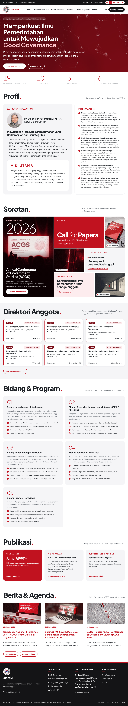
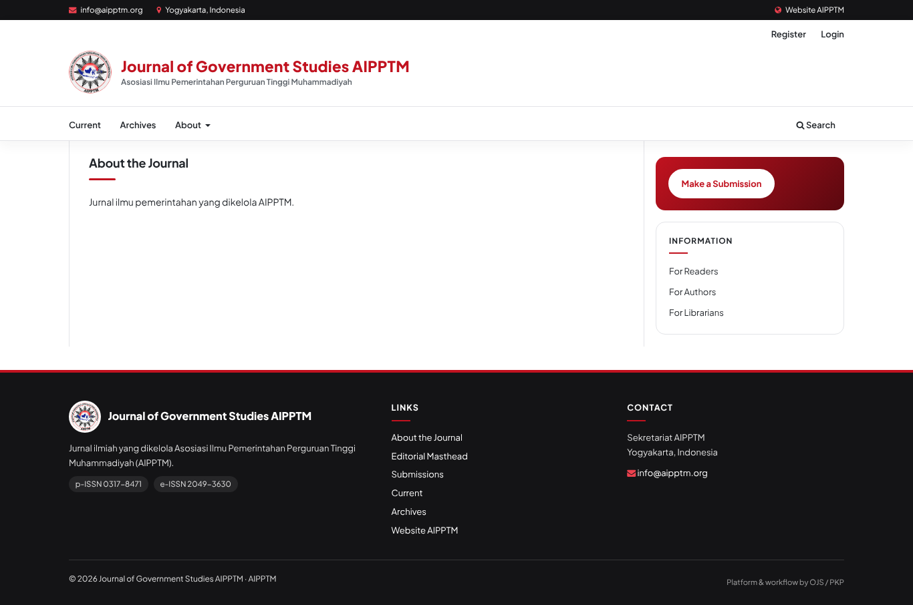

# Website AIPPTM

Tema WordPress dan perangkat pemasangan untuk **www.aipptm.org** (Asosiasi Ilmu Pemerintahan
Perguruan Tinggi Muhammadiyah) dan jurnal **journal.aipptm.org** (OJS 3.5).

Desain mengikuti tampilan www.aipptm.org yang disesuaikan klien: bar atas dan footer hitam, sentuhan
merah. Beranda berisi banner misi, angka, profil (sambutan, visi, misi), mosaik "Sorotan",
direktori anggota PTM, bidang & program, publikasi, serta berita & agenda. Laman Publikasi memuat
**Jurnal Afiliasi** (10 jurnal lengkap dengan sampul, peringkat SINTA, ISSN, penerbit, tautan, dan
penyaring), laman Profil memuat linimasa sejarah, dan laman Direktori memuat 19 perguruan tinggi
anggota. Semua teks, gambar, menu, dan warna bisa diubah dari editor WordPress tanpa koding.

## Isi repositori

| Lokasi | Kegunaan |
|---|---|
| `aipptm-tema.zip` | Tema siap unggah: WordPress › **Tampilan › Tema › Tambahkan Tema › Unggah Tema** |
| `aipptm-ojs-tema.tar.gz` | Tema OJS AIPPTM siap unggah: jurnal › **Settings › Website › Plugins › Upload A New Plugin** |
| `ojs-tema/aipptm/` | Kode sumber tema OJS (child dari Default Theme, diuji di OJS 3.5.0-5) |
| `tema/aipptm/` | Kode sumber tema WordPress (tema blok WordPress 6.6+, diuji di WordPress 7.1.4) |
| `server/setup-server.sh` | Pemasang server Google Cloud (Ubuntu 24.04): Apache, PHP 8.3, MariaDB, WordPress, OJS 3.5.0-5, HTTPS, backup |
| `PANDUAN.md` | Panduan lengkap: Google Workspace, Google Cloud, DNS, WordPress, OJS, login Google |
| `tutorial-media-sosial.html`, `panduan-gambar/` | Tutorial bergambar mengubah ikon media sosial |
| `demo-vercel/` | Salinan statis website untuk pratinjau di Vercel (Root Directory: `demo-vercel`) |
| `Logo1.jpg`, `Logo2.jpg` | Logo asli AIPPTM (lambang bulat dan logo mendatar) |

## Cara cepat memasang tema

1. Unduh `aipptm-tema.zip` dari repositori ini (klik berkasnya › **Download raw file**).
2. Di WordPress: **Tampilan › Tema › Tambahkan Tema › Unggah Tema** › pilih zip › **Pasang** › **Aktifkan**.
3. Saat pertama aktif, tema membuat laman contoh (Beranda, Profil, Direktori Anggota, Bidang & Program,
   Jurnal & Publikasi, Agenda, Kontak, dan lainnya), menjadikan Beranda halaman depan, dan memasang lambang AIPPTM sebagai logo dan ikon situs.
   Laman atau pengaturan yang sudah ada tidak ditimpa.

Memperbarui tema yang sudah terpasang: unggah zip yang sama lewat **Unggah Tema** lalu pilih
**Ganti yang terpasang dengan yang diunggah**. Rinciannya ada di `PANDUAN.md` bagian *Memperbarui tema*.

## Tema OJS dan pengaturan jurnal

Site Settings OJS AIPPTM memang lebih sedikit daripada OJS UMT: OJS menyembunyikan tab Appearance,
Plugins, dan lainnya bila situs hanya berisi satu jurnal. Pengaturan itu ada di
**Settings › Website** milik jurnal. Cara memasang tema, daftar letak pengaturan, dan penjelasan
CSS/Footer HTML ada di `PANDUAN.md` bagian *7a*. Di WordPress, menu **Jurnal (OJS)** berisi
tautan langsung ke semua pengaturan OJS.

Untuk server baru dari nol, ikuti `PANDUAN.md`.
