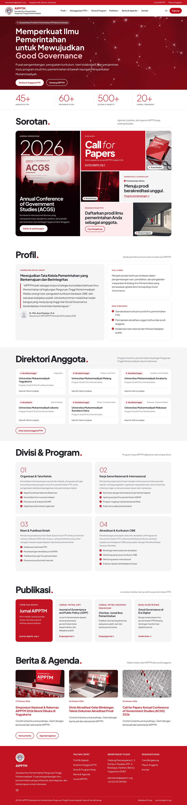

# Website AIPPTM

Tema WordPress dan perangkat pemasangan untuk **www.aipptm.org** (Asosiasi Ilmu Pemerintahan
Perguruan Tinggi Muhammadiyah) dan jurnal **journal.aipptm.org** (OJS 3.5).

Desain: dasar putih, sentuhan merah, footer merah. Beranda berisi banner misi, angka statistik,
mosaik "Sorotan", profil (sambutan, visi, misi), direktori anggota PTM, divisi & program,
publikasi, serta berita & agenda. Semua teks, gambar, menu, dan warna bisa diubah dari editor
WordPress tanpa koding.

## Isi repositori

| Lokasi | Kegunaan |
|---|---|
| `aipptm-tema.zip` | Tema siap unggah: WordPress › **Tampilan › Tema › Tambahkan Tema › Unggah Tema** |
| `tema/aipptm/` | Kode sumber tema yang sama (tema blok WordPress 6.6+, diuji di WordPress 7.1.3) |
| `server/setup-server.sh` | Pemasang server Google Cloud (Ubuntu 24.04): Apache, PHP 8.3, MariaDB, WordPress, OJS 3.5.0-5, HTTPS, backup |
| `PANDUAN.md` | Panduan lengkap: Google Workspace, Google Cloud, DNS, WordPress, OJS, login Google |
| `tutorial-media-sosial.html`, `panduan-gambar/` | Tutorial bergambar mengubah ikon media sosial |
| `Logo1.jpg`, `Logo2.jpg` | Logo asli AIPPTM (lambang bulat dan logo mendatar) |

## Cara cepat memasang tema

1. Unduh `aipptm-tema.zip` dari repositori ini (klik berkasnya › **Download raw file**).
2. Di WordPress: **Tampilan › Tema › Tambahkan Tema › Unggah Tema** › pilih zip › **Pasang** › **Aktifkan**.
3. Saat pertama aktif, tema membuat laman contoh (Beranda, Profil, Direktori Anggota, Divisi & Program,
   Publikasi, Agenda, Kontak, dan lainnya), menjadikan Beranda halaman depan, dan memasang lambang AIPPTM sebagai logo dan ikon situs.
   Laman atau pengaturan yang sudah ada tidak ditimpa.

Untuk server baru dari nol, ikuti `PANDUAN.md`.
